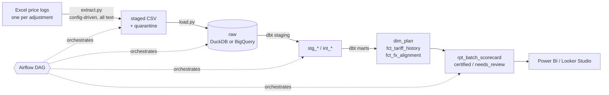

# Indexed Tariff ELT

**From Excel price logs to a tested cloud warehouse: automating tariff certification for a telecom operator that indexes prices to USD.**

In economies with exchange controls, telecom operators publish prices in USD and convert them to local currency at the official exchange rate, sometimes several times a month. Each adjustment arrives as an Excel "price log" (one sheet per business line). Revenue assurance then has to certify that every plan was updated, and converted at the right rate, before the billing and rating systems start charging the new prices.

This repository turns that manual check into a reproducible ELT pipeline:



It's based on my M.Sc. thesis (UNIR, 2025). The thesis built the first version with Pentaho Data Integration, Microsoft SQL Server and Power BI. This version moves the same problem to a modern, testable stack: **Python + dbt + DuckDB/BigQuery + Airflow + Terraform + CI**.

> **All data is synthetic.** The company ("M Communications"), plans, codes, requirement numbers and exchange rates are invented by `generate.py`. No real operator data is included.

## What it catches

The generator injects a small, seeded share of realistic defects, and the pipeline has to find every one of them:

| Defect in the price log | Where it is caught | Result |
|---|---|---|
| Local price not updated although the rate moved | `fct_fx_alignment` → `stale_price` | flagged per plan and log |
| Local price updated to the wrong amount | `fct_fx_alignment` → `misconverted` | deviation in amount and % |
| Plan left out of the log | `rpt_missed_adjustments` | last logged price, last requirement |
| Bundle split (voice/SMS/data) not adding to 100 % or to the price | `rpt_revenue_split_check` | per bundle |
| Row without a billing code | extraction quarantine | kept with reason, never silently dropped |
| Duplicate lines | `int_plan_prices` | de-duplicated and counted |

`rpt_batch_scorecard` rolls these up into one line per price log: **certified** or **needs_review**, with the count of each defect type. That's the sign-off view an analyst needs before a price change goes live.

On the default synthetic run (6 months, 22 price logs), the pipeline flags 8 stale prices, 7 wrong conversions, 7 omitted plans and 4 quarantined rows. That matches the generator's manifest of injected defects; the end-to-end test asserts that the conversion defects match exactly.

## Data model

| Model | Grain | Purpose |
|---|---|---|
| `stg_tariff_batches` | price log | requirement, effective date, official FX rate, cut |
| `int_plan_prices` | plan × log | all price sheets in one shape, de-duplicated |
| `int_tariff_events` | plan × log | price enriched with the batch's rate and the expected local price |
| `dim_plan` | plan | current attributes and price |
| `fct_tariff_history` | plan × version | price history; each version is valid until the next adjustment (type-2 style) |
| `fct_fx_alignment` | plan × log | aligned / stale_price / misconverted |
| `rpt_missed_adjustments` | plan × log | plans that dropped out of a log |
| `rpt_revenue_split_check` | bundle × log | component split consistency |
| `rpt_batch_scorecard` | log | certification verdict |

**Tests:** uniqueness, not-null, accepted values, relationships, composite keys, a positive-value check, and a no-overlap check on the price history. These fail the build. The business-rule checks (conversion, omissions, split) are `warn` tests: they are findings for the analyst, not pipeline bugs.

## Run it

**Local, no cloud account needed (DuckDB):**

```bash
pip install -r requirements-dev.txt
make pipeline        # generate -> extract -> load -> dbt build -> scorecard + CSV exports
make test            # unit tests + full end-to-end run with assertions
```

The marts are exported to `data/exports/*.csv` for Power BI or Excel. The DuckDB file is at `data/warehouse.duckdb`.

**On Google BigQuery:**

```bash
cd infra/terraform && cp terraform.tfvars.example terraform.tfvars   # set project_id
terraform init && terraform apply     # bucket + raw/staging/analytics datasets + service account
cd ../.. && cp .env.example .env      # set GCP_PROJECT, GCS_LANDING_BUCKET
gcloud auth application-default login
pip install -r requirements-gcp.txt
set -a && . ./.env && set +a && make cloud
```

The same dbt models run on both engines. They only use dbt's cross-database macros, and the raw layer is loaded as text so typing happens in tested SQL.

**Orchestration:** `airflow/dags/indexed_tariffs_dag.py` chains `extract → load → dbt build → scorecard`. Set `WAREHOUSE_TARGET=bigquery` to point it at the cloud.

**CI** (`.github/workflows/ci.yml`) runs ruff, pytest and the end-to-end DuckDB build, generates dbt docs, checks that the Airflow DAG imports, and validates the Terraform.

## Repository layout

```
config/sheets.yml          layout contract for the price-log workbook
src/tariff_pipeline/       generate.py · extract.py · load.py · report.py
dbt/                       models (staging, intermediate, marts, reports), macros, tests
airflow/dags/              orchestration
infra/terraform/           GCP bucket, BigQuery datasets, service account
tests/                     pytest: generator, extraction, end-to-end
```

## From the thesis to this repo

| Thesis (2025) | This repo |
|---|---|
| One Pentaho transformation per sheet | One config-driven extractor (`config/sheets.yml`) |
| Constants (rate, requirement, date) typed by hand in "Add constants" | Read from the log's metadata sheet |
| Rows without a billing code filtered out | Quarantined with the reason |
| SQL Server tables per sheet | Layered warehouse (raw → staging → analytics) on DuckDB or BigQuery |
| Validation by manual comparison | dbt tests + certification scorecard |
| Power BI chart of price vs. official rate | `fct_tariff_history` and `fct_fx_alignment` ready for any BI tool |

## Author

María Ángel Milano: Electrical Engineer, M.Sc. Business Intelligence, revenue assurance and data engineering.
[LinkedIn](https://linkedin.com/in/maria-angel-milano) · [GitHub](https://github.com/mariaangelmilano-source)
